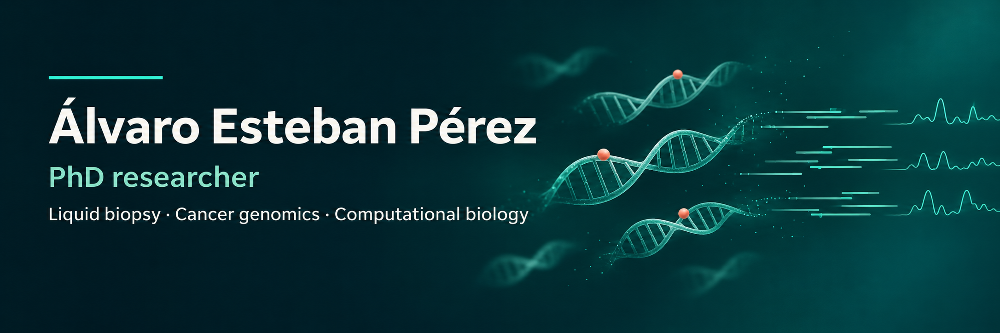

  

PhD researcher working at the intersection of liquid biopsy, ovarian cancer, molecular diagnostics, and computational biology.

My current work focuses on cfDNA/ctDNA analysis in high-grade serous ovarian cancer, integrating genomic, epigenomic, and fragmentomic signals for translational biomarker development.

[Website & research notes](https://alvaroesteban.dev/)

<table align="center">
<tr border="none">
<td width="57%" align="left">  
  
</td>
<td width="43%" align="left">
  
</td>
</tr>
</table>

## Selected projects

- **[Molecular Motion](https://github.com/alvaroestebanperez/molecular-motion)**  
  An open-source library for interactive, animated molecular biology figures. [Explore the demo](https://molecular-motion.alvaroesteban.dev/).

- **[PCA from first principles](https://github.com/alvaroestebanperez/pca-rna-seq-from-scratch)**  
  PCA implemented with NumPy and validated against scikit-learn, applied to matched ovarian cancer RNA-seq data.

## Current interests

- Native cfDNA methylation profiling with nanopore sequencing
- Reproducible bioinformatics and machine learning for biomedical data
- Interactive scientific visualization

## Technical toolkit

  

**Scientific and data tools:** `samtools` · `Dorado` · `modkit` · `SLURM` · `pandas` · `tidyverse` · `scikit-learn`

## Building now

- Nanopore cfDNA methylation pilot workflows
- Liquid biopsy command-line templates
- Reproducible notebooks for ovarian cancer liquid biopsy
